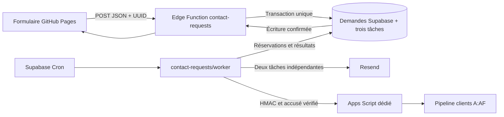

# Demandes de contact Agri-tech V1.2

## Audit de main

Audit effectué à partir de `f139de600ef8d9babaf2f453ae573376c2be4443`.
`index.html#leadForm` est le formulaire public principal. `js/app.js` génère
les choix depuis les services et formations, accepte le lien Formation Agri-tech
Academy, préremplit les liens des cartes et change le libellé du bouton selon le
besoin. Pour les formations, le champ message est effacé, désactivé et masqué.
Le formulaire exige nom, e-mail, téléphone, besoin et consentement. L’ancien
code envoyait un texte de remplacement pour une formation, filtrait le téléphone
et appliquait le honeypot et une limite EmailJS dans le navigateur. Partenariat
et services nécessitaient un message.

Le navigateur confirmait après EmailJS et un POST Apps Script en `no-cors`.
La réponse opaque ne prouvait pas l’écriture dans Leads site web. Le script
fourni comme référence transférait ensuite les lignes vers Pipeline clients.
Il calculait le prochain AGR depuis le maximum existant et cherchait une
correspondance par contact et domaine. Sa routine d’import n’englobait pas
lecture, attribution AGR et écriture sous un verrou. Son écriture A:AE pouvait
remplacer les formules d’une ligne libre. Un incident entre l’écriture et le
marquage du registre laissait le résultat ambigu.

La newsletter utilise sa propre fonction Edge, ses migrations, ses e-mails
Resend et ses tests. Le code public de la newsletter ne dépend pas d’EmailJS ni
de l’URL Apps Script qui figurait dans l’ancien `js/config.js`. Vérifier aussi
les utilisateurs externes du déploiement Apps Script et les déclencheurs Google,
qui ne figurent pas dans le dépôt.

## Correspondance du registre historique « Leads site web »

Le registre confirmé contient les 13 colonnes ci-dessous. Il sert à documenter
la réception et le transfert du formulaire du site. Le suivi commercial se
fait dans `Pipeline clients`.

| N° | Colonne historique | Équivalent pour les nouvelles demandes |
| --- | --- | --- |
| 1 | Date réception | `contact_v12_requests.received_at`, horodaté par Supabase |
| 2 | Nom | `contact_v12_requests.name` |
| 3 | Email | `contact_v12_requests.email` |
| 4 | Téléphone | `contact_v12_requests.phone` |
| 5 | Domaine | `contact_v12_requests.need`, complété par `request_type` |
| 6 | Message | `contact_v12_requests.message`, vide pour une formation |
| 7 | Consentement | `contact_v12_requests.consent` et `consent_version` |
| 8 | Source | `contact_v12_requests.source` |
| 9 | Date formulaire | `received_at` sert de référence pour les nouvelles demandes. L’horodatage du navigateur reste consultable dans le registre pour les anciennes demandes |
| 10 | Statut import pipeline | `contact_v12_jobs.status` pour la tâche `pipeline` |
| 11 | Date import pipeline | `completed_at` si la tâche est `done`. Les tentatives sont suivies par `first_attempt_at`, `last_attempt_at`, `next_attempt_at` et `attempts` |
| 12 | ID dossier pipeline | `contact_v12_jobs.result.dossier_id`. La colonne AF du pipeline stocke l’UUID de la demande |
| 13 | Note import | `last_error` en cas d’échec et `result.possible_duplicate_id` pour un rapprochement commercial |

Conserver le registre et son historique dans Google Sheets avec les accès
existants revus selon la politique de conservation. Aucune purge automatique
ni reprise en masse des anciennes lignes n’est prévue. Après la bascule,
les nouvelles demandes du site vont directement de Supabase au pipeline.

## Architecture



La demande et ses trois tâches sont enregistrées ensemble. Un même UUID et les
mêmes champs normalisés redonnent la confirmation sans recréer de tâches. Le
navigateur garde l’UUID d’une tentative incertaine pour les mêmes champs dans
l’onglet et sa session, avec une empreinte comme clé. Après confirmation, une
nouvelle soumission reçoit son propre UUID. Un changement de contenu ou une
nouvelle session peut créer une demande distincte.

La réception exige une origine autorisée, des choix connus, le consentement,
un corps limité et des champs valides. Les quotas transactionnels sont de 4
nouvelles demandes par adresse, 12 par empreinte réseau si l’en-tête de la
passerelle est configuré et 120 au total sur une heure glissante. Les quotas
s’appliquent après la recherche d’une soumission antérieure. Les empreintes
HMAC sont nettoyées après une heure par le worker. Les origines autorisées
contrôlent les navigateurs. Les quotas s’appliquent également aux clients HTTP.
Une évolution du catalogue requiert la mise à jour de
`supabase/functions/contact-requests/needs.ts` avant le frontend. Le test de
parité détecte les écarts.

Côté pipeline, la même demande retrouve le dossier lié par AF. Une autre
demande mentionnant le même e-mail ou téléphone et le même projet reçoit son
propre dossier, avec un signal de rapprochement dans AE, dans la note de la
cellule AF et dans le résultat de synchronisation. L’équipe décide de la suite
commerciale. Le verrou couvre toutes les écritures du nouveau projet. Le
maximum des AGR présents et le dernier numéro réservé servent au calcul.
Une écriture échouée peut laisser un numéro inutilisé.

## État de production communiqué et diagnostic SQL

`42P07` venait du premier `CREATE TABLE public.contact_requests`, qui
rencontrait une relation homonyme de l’ancien intake. Ce schéma stockait
`receipt_hash`, `payload_hash`, `full_name`, le consentement horodaté et les
états d’envoi dans la demande. V1.2 stocke le besoin et le consentement dans
la demande, et les trois traitements et leurs relances dans une file séparée.
La migration échouée n’avait créé ni les tables techniques ni les RPC, selon
les contrôles communiqués.

La table historique, vide au moment du contrôle, a déjà été renommée
`public.contact_intake_requests` en production. Ne pas répéter le renommage.
La migration V1.2 crée exclusivement `public.contact_v12_requests`,
`public.contact_v12_jobs`, `public.contact_v12_rate` et les RPC
`record_contact_v12_request`, `claim_contact_v12_jobs`,
`finish_contact_v12_job` et `prune_contact_v12_rate`. Les index explicites
et les noms générés des contraintes portent aussi le préfixe V1.2. La migration
est transactionnelle et échoue si un de ses objets est déjà présent. Aucun
objet historique n’est modifié. Le nom initial `public.contact_requests`
reste disponible pour examiner un éventuel besoin de compatibilité avec
l’ancien intake. Le réutiliser pour V1.2 aurait exposé un schéma incompatible
aux anciens consommateurs et aurait pu rencontrer leur index primaire
`contact_requests_pkey`, dont le nom peut survivre au renommage.

La recherche dans les migrations, fonctions Edge, SQL, RLS, JavaScript et
historique Git disponible du dépôt n’a révélé aucun consommateur du schéma
historique ni des champs `receipt_hash`, `payload_hash`,
`notification_state` ou `reply_state`. Les dépendances PostgreSQL par OID
(par exemple une vue ou une clé étrangère) restent liées à la table renommée.
Un appel REST à l’ancien chemin, un client externe ou un corps SQL qui
résout `public.contact_requests` par son nom peut avoir cessé de fonctionner.
Les Edge Functions déployées hors dépôt, autres clients, Cron et automatisations
externes restent à vérifier auprès des propriétaires. Examiner aussi les
journaux d’erreur depuis le renommage.

## 1. Appliquer manuellement la migration Supabase

Lancer d’abord ces contrôles en lecture seule dans le projet réel. Vérifier
les consommateurs externes et clarifier tout objet V1.2 déjà présent avant
d’exécuter une seule fois `202611230002_contact_requests.sql`. Garder le Cron
du contact arrêté.

```sql
select to_regclass('public.contact_requests') as ancien_nom,
       to_regclass('public.contact_intake_requests') as table_historique;
select count(*) from public.contact_intake_requests;

select relkind, relname from pg_class
where relnamespace = 'public'::regnamespace and relname ~ '^contact_v12_';
select oid::regprocedure from pg_proc where pronamespace = 'public'::regnamespace
and proname in ('record_contact_v12_request', 'claim_contact_v12_jobs',
                'finish_contact_v12_job', 'prune_contact_v12_rate');

select pg_describe_object(classid, objid, objsubid) as objet_dependant
from pg_depend where refclassid = 'pg_class'::regclass
and refobjid = to_regclass('public.contact_intake_requests');

select n.nspname, p.proname from pg_proc p join pg_namespace n on n.oid = p.pronamespace
where n.nspname not in ('pg_catalog', 'information_schema')
  and p.prosrc ~ '(contact_requests|contact_intake_requests|receipt_hash|payload_hash|notification_state|reply_state)';
```

Si l’extension Cron est utilisée, vérifier les jobs existants dans son tableau
de bord et leurs destinations. Le résultat du comptage historique est
informatif. Même si des données y ont été ajoutées depuis le premier contrôle,
la migration laisse cette table intacte.

## 2. Vérifier le SQL après migration

Vérifier l’existence des trois tables V1.2, des deux index explicites et des
quatre signatures ci-dessous. Vérifier que les deux clés étrangères
`contact_v12_jobs.request_id` et `contact_v12_rate.request_id` référencent
`contact_v12_requests.id`. Vérifier RLS sur les trois tables et l’absence
d’accès des rôles `anon` et `authenticated`, tables et RPC comprises.
Comparer les contrôles de la table historique avant et après la migration.

```sql
select relname, relrowsecurity,
       has_table_privilege('anon', oid, 'SELECT,INSERT,UPDATE,DELETE') as acces_anon,
       has_table_privilege('authenticated', oid, 'SELECT,INSERT,UPDATE,DELETE') as acces_auth
from pg_class where relnamespace = 'public'::regnamespace and relkind = 'r'
and relname in ('contact_v12_requests', 'contact_v12_jobs', 'contact_v12_rate');

select oid::regprocedure,
       has_function_privilege('anon', oid, 'EXECUTE') as acces_anon,
       has_function_privilege('authenticated', oid, 'EXECUTE') as acces_auth,
       has_function_privilege('service_role', oid, 'EXECUTE') as acces_worker
from pg_proc where pronamespace = 'public'::regnamespace
and proname in ('record_contact_v12_request', 'claim_contact_v12_jobs',
                'finish_contact_v12_job', 'prune_contact_v12_rate');
```

## 3. Déployer la fonction Edge

Vérifier dans le tableau de bord que le slug `contact-requests` est libre
ou réservé à cette PR. Si une fonction indépendante utilise déjà ce slug,
identifier ses consommateurs avant tout remplacement. Depuis la branche
de la PR, exécuter
`supabase functions deploy contact-requests --project-ref <ref-production>`.
La configuration maintient les parcours publics du contact et de la newsletter.
Le chemin `/worker` vérifie son propre secret. Garder le frontend existant
et le Cron à l’arrêt. Tant que `CONTACT_RATE_SECRET` manque, l’entrée de contact
répond avec un état incertain et ne soumet aucune transaction.

## 4. Configurer les secrets

Configurer dans Supabase Dashboard, **Edge Functions → Secrets**. Utiliser des
clés aléatoires indépendantes pour le worker, le pipeline et les quotas.

| Variable | Valeur attendue |
| --- | --- |
| `SUPABASE_URL`, `SUPABASE_SERVICE_ROLE_KEY` | Variables intégrées au runtime Supabase |
| `CONTACT_RESEND_API_KEY` ou `RESEND_API_KEY` | Clé d’envoi serveur. La seconde sert de repli |
| `CONTACT_FROM` | Identité d’expédition vérifiée par Resend |
| `CONTACT_ADMIN_EMAIL` | Boîte Agri-tech autorisée pour les notifications |
| `CONTACT_SITE_ORIGINS` | Origines exactes séparées par des virgules, sans slash final. Par défaut `https://agritech509ht.com` |
| `CONTACT_RATE_SECRET` | Clé HMAC des empreintes de quota |
| `CONTACT_TRUSTED_IP_HEADER` | Facultatif. Configurer uniquement si l’ingress écrase les valeurs du client |
| `CONTACT_WORKER_SECRET` | Clé d’authentification du worker. Même valeur dans Vault lors de l’étape 7 |
| `CONTACT_PIPELINE_URL` | Après l’étape 5, URL HTTPS `/exec?agri_contact_v12=1` publiée depuis le projet Google Form |
| `CONTACT_PIPELINE_SECRET` | Même chaîne que la propriété du projet Apps Script partagé |

Vérifier les quotas Resend, qui sont partagés entre les clés d’un même compte.
Le traitement du contact conserve des états et des clés d’idempotence
distincts de la newsletter. Resend déduplique pendant 24 h. La livraison n’est
retentée automatiquement que dans les 23 h suivant la première tentative.

## 5. Installer le connecteur dans le projet qui exécute Google Form

La colonne AF `ID demande Supabase`, la configuration du service Sheets API,
les deux propriétés et le premier audit ont déjà été effectués dans le
projet autonome. Le classeur a confirmé A:AF, 284 lignes de données utilisées,
985 lignes de grille et des formules en V, W, X, AA et AB. Garder ce travail
comme référence. Le verrou de ce projet autonome ne couvre pas le Google Form.
Le connecteur doit être exécuté **dans le projet Apps Script du déclencheur
Google Form**, avec un déploiement Web versionné de ce projet. L’accès ou les
paramètres d’un projet Apps Script ne sont pas transférés par l’ajout d’un
fichier dans un autre projet.

1. Dans le projet Google Form, relever la fonction installée sur le
   déclencheur, l’ancien code de réservation AGR, l’écriture finale et les
   autres écrivains vers le même onglet. Sauvegarder le code et les versions
   de déploiement. Le script du Google Form n’étant pas dans le dépôt, les noms
   `onFormSubmit`, `sheet` et `pipelineRow` ci-dessous sont des exemples.
   Appliquer la correspondance vérifiée dans l’éditeur, sans changer la
   fonction que le déclencheur appelle. Si un autre écrivain attribue des AGR
   ou choisit les mêmes lignes, il doit aussi utiliser ce projet/verrou ou
   être arrêté pendant les écritures contrôlées et avant l’automatisation. Examiner aussi les scripts
   du classeur et éviter l’attribution manuelle d’AGR pendant la recette.
2. Ajouter le fichier `apps-script/ContactPipeline.gs` au projet Google Form.
   Activer le service avancé Sheets v4 avec l’identifiant `Sheets`. Dans les
   propriétés de **ce projet**, renseigner `PIPELINE_SPREADSHEET_ID` pour le
   classeur réel et `CONTACT_PIPELINE_SECRET` avec la valeur serveur.
3. Dans le fichier actuel du Form, entourer la fonction installée avec le
   verrou commun. Pour un déclencheur `onFormSubmit`, renommer l’ancienne
   fonction en `agriGoogleFormOriginal_` et ajouter le wrapper suivant.
   Garder tous les calculs et règles de qualification dans le corps original.
   Si ce corps acquiert déjà un verrou, déplacer la protection autour du
   corps avec ce wrapper et retirer l’acquisition imbriquée autour de la même
   écriture. Le verrou doit couvrir toute lecture servant à choisir un AGR
   ou à écrire dans le pipeline.

   ```javascript
   function onFormSubmit(e) {
     return withAgriPipelineLock_(() => agriGoogleFormOriginal_(e), null, 120000);
   }
   ```

   Dans `agriGoogleFormOriginal_`, à l’endroit où l’AGR est attribué, utiliser
   `const idDossier = nextAgriPipelineFormId_(sheet);`. Reprendre exactement
   l’ancien tableau A:AE et remplacer son écriture rectangulaire, ainsi que
   sa sélection préalable de ligne, par
   `const targetRow = writeAgriPipelineFormRow_(sheet, pipelineRow);`.
   Utiliser la ligne retournée pour tout traitement ultérieur. Les champs
   commerciaux existants sont repris. V, W, X, AA et AB sont alimentées par
   leurs formules et AF reste réservée au site. Vérifier qu’aucune autre
   écriture finale ou copie d’une ligne A:AF ne les remplace. Si l’ancien
   script écrit plusieurs blocs, attend des valeurs non calculées dans ces
   cinq colonnes ou n’utilise pas un tableau A:AE, relever précisément ces
   écarts et adapter la conversion avant de publier le connecteur.
4. Ajouter le routage HTTP suivant. Si le projet a déjà un `doPost`, renommer
   sa définition `agriPreviousDoPost_` dans la nouvelle version et utiliser
   la variante avec le retour historique. Les autres routes sont inchangées.

   ```javascript
   function doPost(e) {
     if (e && e.parameter && e.parameter.agri_contact_v12 === '1') {
       return handleAgriContactPost_(e);
     }
     // Si ce projet possède déjà un doPost, remplacer ce return par
     // return agriPreviousDoPost_(e);
     return ContentService.createTextOutput('not_found');
   }
   ```

5. Exécuter `auditContactPipelineLayout` depuis le projet partagé. Vérifier
   la prochaine ligne, les formules attendues, validations, protections et
   formats de dates B et Z. Si la ligne cible manque de formules, configurer
   le modèle approuvé via `CONTACT_PIPELINE_FORMULA_TEMPLATE_ROW`. Préparer, si nécessaire, une ligne neuve après
   les dossiers sans écraser les lignes existantes. Publier une application
   Web versionnée, exécutée sous le compte autorisé, accessible sans session
   Google pour permettre le POST HMAC. Reporter son URL routée dans
   `CONTACT_PIPELINE_URL`. Laisser `CONTACT_PIPELINE_SHARED_WRITER` absent
   jusqu’à la validation du verrou, des autres écrivains et des lignes cibles
   à l’étape 6. Le connecteur renvoie `writer_not_ready` tant que cette
   propriété ne vaut pas `verified`.

Le POST signe la chaîne UTF-8 `v1\n<timestamp>\n<payload>` avec HMAC-SHA256.
Le corps contient `timestamp`, la chaîne exacte `payload` et la signature hex.
La signature dans le corps évite de dépendre d’en-têtes que `doPost` ne lit
pas. La fenêtre de deux minutes rejette les anciens messages. Dans la
fenêtre, AF rend le rejeu sans seconde insertion. Les deux écrivains lisent
le maximum existant et réservent le prochain AGR sous le même verrou.
Le lot Sheets préserve les colonnes calculées, écrit les chaînes comme du
texte littéral et enregistre l’UUID dans le même lot que le dossier web.
Un numéro réservé avant une écriture échouée peut laisser un saut.

## 6. Vérifier de façon contrôlée sur les ressources réelles

- Garder l’ancien frontend, les déclencheurs et le Cron de contact dans
  leur état actuel. Vérifier d’abord sans écriture que le worker refuse une
  mauvaise clé, et que l’endpoint Apps Script refuse une signature invalide.
  Relever la prochaine ligne et les formules de contrôle via l’audit.
- Avant tout essai d’écriture, confirmer que le site et le Form utilisent
  le même projet et que les autres écrivains ne peuvent pas intervenir dans
  le même espace pendant l’essai. Soumettre uniquement des données fictives
  clairement marquées `TEST TECHNIQUE`, avec accord des responsables du
  pipeline et de la boîte administrative. Suivre cette demande par UUID et
  AGR. Neutraliser son suivi commercial en la marquant par le processus
  prévu par l’équipe. Laisser le numéro et les traces en place.
- Avec le Cron arrêté et le frontend historique conservé, soumettre un seul
  appel au nouvel endpoint via un outil de recette autorisé au nom d’une
  origine configurée. Utiliser une boîte de réception interne pour le
  demandeur. Vérifier en SQL la demande et les trois tâches en attente.
  Mettre `CONTACT_PIPELINE_SHARED_WRITER=verified` dans le projet partagé
  seulement après les vérifications de l’étape 5. Appeler ensuite
  `POST /functions/v1/contact-requests/worker?request_id=<uuid-de-recette>`
  côté serveur avec `X-Contact-Worker`. Le filtre UUID limite le worker
  à cette demande. Vérifier les deux e-mails, l’AGR lié en AF, les champs,
  les validations et les formules V, W, X, AA, AB. Vérifier aussi le Google
  Form avec une réponse fictive approuvée. Configurer la surveillance des échecs du déclencheur Form. Après une
  expiration du verrou, la réponse source est à rapprocher avec son
  dossier éventuel avant une reprise manuelle. Vérifier cette procédure
  avec le propriétaire du déclencheur.
- Rejouer la soumission avec le même UUID et relancer le worker ciblé.
  Vérifier qu’il reste un dossier par UUID. En cas de réponse Apps Script
  ambiguë, vérifier AF avant toute reprise manuelle et garder le même
  UUID pour une relance. Comparer les anciens dossiers et les formules
  à partir de contrôles en lecture seule. Garder l’ancien flux en service
  tant que la recette reste incomplète.

## 7. Activer le worker automatique puis le Cron après validation

Après validation, réconcilier le registre du site historique avec le pipeline.
Contrôler les statuts vides, `À importer`, `Erreur`, `Doublon potentiel` et
`Importé` sans AGR valable. Garder les anciennes lignes, y compris
`Hors pipeline`. Si l’ancien importateur web alloue les mêmes AGR hors du
projet partagé, suspendre son seul déclencheur **après la recette approuvée**
et avant le nouveau Cron. Garder l’ancien endpoint en réception pendant la
fenêtre de bascule. Recenser les lignes tardives et les rapprocher manuellement.
Si des réponses Google Form passent par l’ancien importateur, attendre la
séparation vérifiée de ces flux avant toute suspension.

Après accord explicite, vérifier Cron et pg_net, placer dans Vault
`contact_worker_url` (URL complète de la fonction suivie de `/worker`) et
`contact_worker_secret` (même valeur que le secret Edge), puis planifier le job.

```sql
select cron.schedule('contact-requests-worker', '* * * * *', $worker$
  select net.http_post(
    url := (select decrypted_secret from vault.decrypted_secrets where name = 'contact_worker_url'),
    headers := jsonb_build_object(
      'Content-Type', 'application/json',
      'X-Contact-Worker', (select decrypted_secret from vault.decrypted_secrets where name = 'contact_worker_secret')
    ),
    body := '{}'::jsonb,
    timeout_milliseconds := 55000
  );
$worker$);
```

Le worker réserve jusqu’à six tâches via `FOR UPDATE SKIP LOCKED`.
Un bail de dix minutes dépasse les délais des appels Edge et la durée
d’exécution Apps Script courante. Les mises à jour de fin exigent le jeton
du bail actif. Un incident après acceptation chez le prestataire reste
possible. La clé Resend et AF traitent ces résultats ambigus. Les erreurs
réessayables suivent un délai croissant, jusqu’à six tentatives d’envoi.
Pour le pipeline, une reprise attend au moins dix minutes après un
échec afin de laisser se terminer un appel Apps Script dont l’accusé
a été perdu. Les échecs définitifs apparaissent dans `last_error` et la demande passe à
`attention`. Limiter l’accès à Vault, aux résultats et aux journaux pg_net.

## 8. Publier le formulaire et prévoir le retour arrière

Après vérification du Cron, publier le frontend validé et relever l’heure.
Surveiller la réception, Resend, AF et les flux Google Form et newsletter.
Réconcilier les onglets chargés avant la bascule avec le registre historique
et Supabase. Désactiver EmailJS et le déploiement historique du site seulement
après validation et dernier rapprochement. Si un déploiement est partagé,
préserver ses autres entrées. Le registre reste consultable en historique.

Pour revenir en arrière, arrêter d’abord le Cron
(`select cron.unschedule('contact-requests-worker');`), suspendre les appels
manuels et attendre la fin des exécutions et des baux actifs. Retirer la
propriété `CONTACT_PIPELINE_SHARED_WRITER` pour bloquer le connecteur.
Recenser les tâches et les dossiers déjà synchronisés. Restaurer la version
précédente du frontend avec ses intégrations, puis reprendre uniquement
l’ancien importateur web après vérification. Si le wrapper du Google Form
pose problème, restaurer son code sauvegardé et vérifier sa réponse suivante.
Conserver la réception Supabase pendant le chevauchement des onglets ouverts
et rapprocher les demandes reçues. Garder la table historique, les tables V1.2,
les journaux, les AGR et les dossiers existants. Relancer avec les mêmes UUID
après correction du défaut qui a motivé l’arrêt.

## Incident de synchronisation après installation

Le test réel a enregistré l’UUID `a47b9c16-93c2-49bb-8fc1-5c4b83de9251`.
Les deux tâches Resend ont obtenu un identifiant d’acceptation. La tâche
`pipeline` a conservé `delivery_unconfirmed`, et le dossier n’a pas été
retrouvé en AF lors du contrôle communiqué. Dans l’ancienne version, une
exception réseau, un délai dépassé et une réponse non JSON pouvaient tous
donner ce même code. Le HTTP 200 `worker_complete` confirme la fin du lot,
y compris lorsqu’une tâche repart en attente. L’exécution Apps Script
« Terminée » indique seulement que le script a terminé. Rapprocher son
horodatage de `last_attempt_at` avant toute attribution. Les réponses
`{"processed":0}` ne correspondent pas au format de ce worker.

### Mise à jour sans réinstaller le SQL

1. Dans le **projet partagé Google Form**, choisir une ligne existante et
   approuvée contenant les cinq formules de suivi V, W, X, AA et AB.
   Vérifier les références relatives et absolues de cette ligne. Enregistrer
   son numéro dans la propriété `CONTACT_PIPELINE_FORMULA_TEMPLATE_ROW`.
   La ligne modèle doit précéder la ligne cible. La cible observée était 79
   lors du diagnostic, mais elle peut avoir avancé depuis. Le connecteur
   copie seulement les formules absentes, dans le même lot atomique que
   l’AGR et AF, et laisse les formules existantes en place. Le Google Form
   utilise le même mécanisme. Si le modèle manque ou est incomplet pour une
   cellule à remplir, le lot est refusé sans créer de dossier.
2. Mettre à jour `ContactPipeline.gs` dans ce projet et publier une **nouvelle
   version du déploiement Web**. Conserver le routage
   `agri_contact_v12=1` de `doPost(e)`. Dans « Gérer les déploiements »,
   comparer en privé l’URL du déploiement partagé à la valeur de
   `CONTACT_PIPELINE_URL`, avec `/exec?agri_contact_v12=1`. Une URL de
   l’ancien projet autonome ou une URL `/dev` est à corriger. Redéployer
   ensuite l’Edge Function depuis la PR. Conserver la migration installée,
   les secrets Vault, le déclencheur Google Form et le Cron de contact à l’arrêt.
3. Effectuer un seul diagnostic sans écriture. Utiliser le worker authentifié
   depuis Supabase et ne consulter que son statut et son code de réponse.

   ```sql
   select net.http_post(
     url := (select decrypted_secret from vault.decrypted_secrets
             where name = 'contact_worker_url') || '?probe=pipeline',
     headers := jsonb_build_object(
       'X-Contact-Worker', (select decrypted_secret from vault.decrypted_secrets
                            where name = 'contact_worker_secret')
     ),
     body := '{}'::jsonb,
     timeout_milliseconds := 30000
   ) as request_id;
   ```

   Dans `net._http_response`, filtrer sur cet identifiant et lire
   `status_code` et `content` uniquement. Le diagnostic signe un message
   dépourvu de coordonnées, vérifie la réponse de la version attendue et
   ne réserve aucune tâche. `pipeline_ready` confirme le routage, la
   signature et la version. L’accès effectif au classeur et l’écriture se
   vérifient lors de la reprise de l’UUID.
4. Après `pipeline_ready`, vérifier AF pour l’UUID de recette, puis relancer
   uniquement cet UUID avec `?request_id=a47b9c16-93c2-49bb-8fc1-5c4b83de9251`
   une fois la tâche `pipeline` éligible selon `next_attempt_at`. Garder
   les tâches e-mail déjà `done`. Vérifier `pipeline=done`, le
   `result.dossier_id`, l’UUID dans AF et les cinq formules de la nouvelle
   ligne. Si AF contient déjà l’UUID, la reprise retourne l’AGR existant.

### Lecture des nouveaux codes

| Code | Diagnostic |
| --- | --- |
| `pipeline_endpoint`, `pipeline_route`, `pipeline_version` | Vérifier l’URL `/exec`, le paramètre de routage et la version publiée du projet partagé |
| `pipeline_redirect` | Redirection inattendue, notamment vers une page de connexion. Le worker suit uniquement la redirection de Google ContentService vers `script.googleusercontent.com/macros/echo` par GET sans renvoyer le corps signé |
| `pipeline_timeout`, `pipeline_transport`, `pipeline_http_<statut>` | Incident réseau, délai dépassé ou erreur HTTP. Vérifier AF avant toute reprise manuelle |
| `pipeline_response_format`, `pipeline_ack` | Réponse non JSON ou accusé incompatible |
| `pipeline_unauthorized`, `pipeline_writer_not_ready` | Vérifier le secret des deux côtés et la propriété d’activation du projet partagé |
| `pipeline_invalid` pendant la sonde | Un ancien déploiement peut rejeter le message de diagnostic. Vérifier la version publiée |
| `pipeline_layout`, `pipeline_formula_template`, `pipeline_sheet_access`, `pipeline_sheet_write` | Contrôler la ligne, le modèle, les droits Sheets ou l’échec de l’écriture |
| `pipeline_busy`, `pipeline_unconfirmed`, `pipeline_internal` | Verrou occupé, erreur Apps Script sans détail ou exception interne du worker |

Les diagnostics émettent uniquement des codes fixes. Les réponses Google,
les URL de redirection, les signatures et les données des demandes ne
figurent ni dans `last_error` ni dans la réponse du diagnostic.

## Exploitation et confidentialité

Dans Supabase, consulter les tâches par `request_id`. Les résultats contiennent
l’identifiant Resend ou le dossier AGR et le rapprochement potentiel. Un
identifiant Resend confirme l’acceptation par l’API. Les événements du compte
Resend permettent de vérifier la livraison ou le rejet par le destinataire.

Pour reprendre une tâche en échec après avoir corrigé sa cause, exécuter en
administration la requête ci-dessous avec l’UUID et le type exacts. En cas de
modification des paramètres Resend, vérifier aussi le contenu de la première
tentative. La clé Resend déduplique dans une fenêtre de 24 h et l’envoi
automatique s’arrête au bout de 23 h. Au-delà, rapprocher manuellement le journal
Resend et la boîte concernée avant toute décision de renvoi.

```sql
update public.contact_v12_jobs
set status = 'pending', attempts = 0, next_attempt_at = now(),
    completed_at = null, lease_token = null
where request_id = '<uuid>'::uuid
  and kind = '<admin_email | receipt_email | pipeline>'
  and status = 'failed'
  and (kind = 'pipeline' or first_attempt_at > now() - interval '23 hours');
```

Restreindre les accès au projet Supabase, au classeur, à Apps Script, à Resend
et à la boîte administrative. Examiner les dossiers au plus tard 12 mois
après la clôture du suivi, avec une revue périodique des demandes restées sans
suite. Identifier les données à conserver au titre d’une obligation applicable.
Pour les demandes de rectification ou de suppression, vérifier l’identité du
demandeur avec le minimum d’informations puis retrouver le dossier via l’UUID
et l’AGR. Si une tâche est encore en cours, suspendre le worker et attendre la
fin des baux avant intervention. Coordonner la correction ou suppression dans
Supabase, le pipeline, les messages et les prestataires selon leurs capacités
et règles de rétention. La suppression de la demande dans Supabase supprime
ses tâches et empreintes associées. Traiter les anciennes copies et sauvegardes
selon leur échéance documentée. Les inscriptions newsletter gardent leur
propre procédure.

## Tests reproductibles

Avec Node.js 24, exécuter depuis la racine du dépôt les tests unitaires,
puis les tests avec PGlite et Chromium. Les tests contact et newsletter
utilisent des services simulés et des données fictives.

```sh
node --test tests/*.test.mjs
npm install --prefix /tmp/agritech-contact-tests @electric-sql/pglite@0.6.0 playwright@1.65.1
NODE_PATH=/tmp/agritech-contact-tests/node_modules node tests/contact-requests-db.mjs
NODE_PATH=/tmp/agritech-contact-tests/node_modules node tests/newsletter-db.mjs
NODE_PATH=/tmp/agritech-contact-tests/node_modules node tests/newsletter-browser.mjs
deno check supabase/functions/contact-requests/index.ts
```

Les tests reproduisent notamment le renommage historique avec son index
primaire, sa politique et une vue dépendante. Le connecteur simulé vérifie
l’alternance entre les deux sources, les formules protégées et le rejeu.
Le déploiement Apps Script partagé, Resend et l’Edge Function hébergée
restent à vérifier lors des essais contrôlés.
