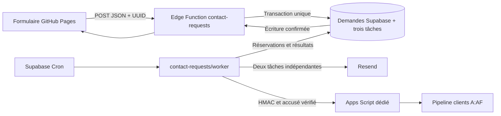

# Demandes de contact Agri-tech V1.2

## Audit de main

Audit effectué à partir de `f139de600ef8d9babaf2f453ae573376c2be4443`.
`index.html#leadForm` est le formulaire public principal. `js/app.js` génère
les choix depuis les services et formations, accepte le lien Formation Agri-tech
Academy, préremplit les liens des cartes et change le libellé du bouton selon le
besoin. Pour les formations, le champ message est effacé, désactivé et masqué.
Le formulaire exige nom, e-mail, téléphone, besoin et consentement. L’ancien
code envoyait un texte de remplacement pour une formation, filtrait le téléphone
et appliquait le honeypot et une limite EmailJS dans le navigateur. Partenariat
et services nécessitaient un message.

Le navigateur confirmait après EmailJS et un POST Apps Script en `no-cors`.
La réponse opaque ne prouvait pas l’écriture dans Leads site web. Le script
fourni comme référence transférait ensuite les lignes vers Pipeline clients.
Il calculait le prochain AGR depuis le maximum existant et cherchait une
correspondance par contact et domaine. Sa routine d’import n’englobait pas
lecture, attribution AGR et écriture sous un verrou. Son écriture A:AE pouvait
remplacer les formules d’une ligne libre. Un incident entre l’écriture et le
marquage du registre laissait le résultat ambigu.

La newsletter utilise sa propre fonction Edge, ses migrations, ses e-mails
Resend et ses tests. Le code public de la newsletter ne dépend pas d’EmailJS ni
de l’URL Apps Script qui figurait dans l’ancien `js/config.js`. Vérifier aussi
les utilisateurs externes du déploiement Apps Script et les déclencheurs Google,
qui ne figurent pas dans le dépôt.

## Architecture



La demande et ses trois tâches sont enregistrées ensemble. Un même UUID et les
mêmes champs normalisés redonnent la confirmation sans recréer de tâches. Le
navigateur garde l’UUID d’une tentative incertaine pour les mêmes champs dans
l’onglet et sa session, avec une empreinte comme clé. Après confirmation, une
nouvelle soumission reçoit son propre UUID. Un changement de contenu ou une
nouvelle session peut créer une demande distincte.

La réception exige une origine autorisée, des choix connus, le consentement,
un corps limité et des champs valides. Les quotas transactionnels sont de 4
nouvelles demandes par adresse, 12 par empreinte réseau si l’en-tête de la
passerelle est configuré et 120 au total sur une heure glissante. Les quotas
s’appliquent après la recherche d’une soumission antérieure. Les empreintes
HMAC sont nettoyées après une heure par le worker. Les origines autorisées
contrôlent les navigateurs. Les quotas s’appliquent également aux clients HTTP.
Une évolution du catalogue requiert la mise à jour de
`supabase/functions/contact-requests/needs.ts` avant le frontend. Le test de
parité détecte les écarts.

Côté pipeline, la même demande retrouve le dossier lié par AF. Une autre
demande mentionnant le même e-mail ou téléphone et le même projet reçoit son
propre dossier, avec un signal de rapprochement dans AE, dans la note de la
cellule AF et dans le résultat de synchronisation. L’équipe décide de la suite
commerciale. Le verrou couvre toutes les écritures du nouveau projet. Le
maximum des AGR présents et le dernier numéro réservé servent au calcul.
Une écriture échouée peut laisser un numéro inutilisé.

## 1. Préparer Supabase

1. Utiliser un projet de test distinct et une copie statique du site. Configurer
   l’URL Supabase publique de cette copie dans `js/config/supabase-config.js`.
   Examiner la migration `202611230002_contact_requests.sql` et l’appliquer
   manuellement au projet choisi. Les tables sont sous RLS et les RPC métier
   sont réservées à `service_role`. Vérifier les droits de `anon` et
   `authenticated` après installation.
2. Configurer les variables suivantes dans les secrets Edge Functions. Utiliser
   des secrets aléatoires indépendants pour le worker, la signature et les quotas.

   | Variable | Rôle |
   | --- | --- |
   | `SUPABASE_URL`, `SUPABASE_SERVICE_ROLE_KEY` | Variables serveur intégrées au runtime Supabase |
   | `CONTACT_RESEND_API_KEY` ou `RESEND_API_KEY` | Clé d’envoi serveur dédiée si possible. La seconde sert de repli si la première est absente |
   | `CONTACT_FROM` | Adresse ou identité d’expédition vérifiée chez Resend |
   | `CONTACT_ADMIN_EMAIL` | Boîte administrative autorisée |
   | `CONTACT_SITE_ORIGINS` | Origines exactes séparées par des virgules, sans slash final. Par défaut `https://agritech509ht.com` |
   | `CONTACT_RATE_SECRET` | Clé HMAC des empreintes de limitation |
   | `CONTACT_TRUSTED_IP_HEADER` | Facultatif. Configurer seulement après avoir vérifié que la passerelle écrase toute valeur fournie par le client |
   | `CONTACT_WORKER_SECRET` | Authentification Cron vers le worker |
   | `CONTACT_PIPELINE_URL` | URL HTTPS `/exec` du nouveau déploiement Apps Script |
   | `CONTACT_PIPELINE_SECRET` | Clé HMAC identique à la propriété Apps Script |

   Vérifier la capacité Resend avant l’activation. Des clés distinctes du
   même compte partagent ses quotas. Utiliser des comptes distincts si les
   quotas d’envoi doivent être indépendants.

3. Déployer depuis le clone avec `supabase functions deploy contact-requests --project-ref <ref>`.
   La configuration du dépôt désactive la vérification JWT de cette seule route
   en plus de la route newsletter déjà publique. Le worker vérifie son propre secret.
4. Dans Supabase, activer Cron et pg_net dans le projet choisi. Dans Vault, créer
   `contact_worker_url` (URL complète de la fonction suivie de `/worker`) et
   `contact_worker_secret` (même valeur que `CONTACT_WORKER_SECRET`). Le SQL
   ci-dessous sert à activer le worker lorsque les destinataires et le pipeline
   de l’environnement ont été vérifiés.

```sql
select cron.schedule('contact-requests-worker', '* * * * *', $worker$
  select net.http_post(
    url := (select decrypted_secret from vault.decrypted_secrets where name = 'contact_worker_url'),
    headers := jsonb_build_object(
      'Content-Type', 'application/json',
      'X-Contact-Worker', (select decrypted_secret from vault.decrypted_secrets where name = 'contact_worker_secret')
    ),
    body := '{}'::jsonb,
    timeout_milliseconds := 55000
  );
$worker$);
```

Le worker réserve jusqu’à six tâches par exécution avec un bail de trois
minutes. Un bail expiré permet la reprise après incident. Les erreurs
réessayables reprennent avec des délais croissants, jusqu’à six tentatives
d’envoi, puis passent à `failed`. La demande passe à `attention` si une
tâche échoue définitivement. Elle passe à `processed` quand les trois
tâches sont terminées. Les erreurs sont enregistrées sous forme de codes.
Limiter l’accès à Vault, aux résultats techniques et aux journaux pg_net,
qui peuvent conserver des métadonnées de la requête.

## 2. Préparer Apps Script sur une copie

1. Dupliquer le classeur réel dans un espace de test restreint. Utiliser des
   données fictives pour la recette et retirer les données réelles de cette
   copie avant de l’utiliser en test. Examiner la ligne 1, les formules
   individuelles et matricielles, validations, formats (en particulier les
   dates B et Z), protections, plages utilisées et automatisations.
2. Confirmer les noms et l’ordre A:AE reproduits dans
   `apps-script/ContactPipeline.gs`. Si AF est libre, mettre
   `ID demande Supabase` en AF1. Si AF est occupée ou si les en-têtes
   divergent, adapter le code après vérification du classeur avant de
   déployer. Ne pas insérer de colonne entre A et AE.
3. Créer un projet Apps Script autonome avec le runtime V8 et y coller
   `ContactPipeline.gs`. Dans Services, ajouter Google Sheets API v4 avec
   l’identifiant `Sheets`. Activer l’API dans le projet Cloud associé si
   celui-ci est géré manuellement. Ajouter aux propriétés du script
   `PIPELINE_SPREADSHEET_ID` et `CONTACT_PIPELINE_SECRET`. Autoriser le
   compte d’exécution à modifier le classeur cible.
4. Exécuter `auditContactPipelineLayout` dans l’éditeur. Son résultat affiche
   les volumes de formules par colonne. Vérifier sur la copie les formules
   conservées dans les colonnes non renseignées, notamment AA, ainsi que les
   listes déroulantes et les résultats visibles. Le script écrit seulement
   dans les champs qu’il renseigne et refuse une ligne cible si l’un de ces
   champs contient déjà une valeur ou une formule. Préparer des lignes vierges
   déjà formatées et validées après les dossiers, avec les formules nécessaires
   dans les colonnes ignorées. Éviter les valeurs préremplies dans ces lignes.
5. Déployer en application Web, avec exécution sous le compte autorisé et
   accès permettant l’appel sans session Google. Si la politique Workspace
   interdit cet accès, le déploiement doit être revu avant la bascule.
   Reporter l’URL `/exec` dans les secrets Supabase. Les web apps Apps Script
   ne rendent pas les en-têtes personnalisés accessibles au handler. Le POST
   JSON contient donc `timestamp`, `payload` (chaîne JSON exacte) et
   `signature` (HMAC-SHA256 hexadécimal de `v1\n<timestamp>\n<payload>`
   en UTF-8). La fenêtre de deux minutes et l’UUID conservé en AF empêchent
   une seconde insertion issue d’un rejeu. Une relance légitime signe de
   nouveau le payload. Supabase exige un accusé `synced` avec le même UUID
   et un dossier AGR valide.
6. Envoyer plusieurs demandes de test, dont deux en parallèle et une relance
   après réponse perdue. Vérifier les formats, formules, validations et
   automatisations réelles. L’API Sheets écrit la ligne en un lot atomique
   sous verrou et encode les textes comme des chaînes littérales, y compris
   les valeurs commençant par `=`, `+`, `-` ou `@`. La zone destinée
   aux insertions doit être réservée au script durant la synchronisation.
   Le verrou Apps Script ne coordonne ni un autre projet ni les modifications
   manuelles concurrentes.

## 3. Recette, bascule et retour arrière

- Sur l’environnement isolé, vérifier service, formation avec message masqué,
  partenariat, consentement, rejet serveur et reprise d’une réponse incertaine.
  Contrôler une demande et trois tâches par UUID. Utiliser des boîtes de
  recette autorisées et une adresse d’envoi vérifiée. Tester séparément les
  échecs des deux e-mails et du pipeline ainsi que leur reprise. Vérifier
  l’inscription newsletter avec son propre protocole de recette.
- Une fois la recette approuvée, préparer le classeur existant et son nouveau
  projet Apps Script selon les mêmes contrôles. Installer migration, secrets
  et fonction sur l’environnement cible. Garder le Cron de contact à l’arrêt
  pendant la bascule commerciale. Conserver les versions du site et des
  déploiements permettant le retour arrière.
- Publier le nouveau frontend lorsque la réception Supabase est prête. Tester
  son enregistrement contrôlé avant de désactiver quoi que ce soit. L’ancien
  Apps Script et EmailJS peuvent encore recevoir des soumissions depuis des
  onglets chargés avant la publication. Relever l’heure de bascule et drainer
  le registre Leads site web avec l’ancien importateur. Comparer les envois
  EmailJS, le registre, le pipeline et Supabase autour de cette heure.
- Arrêter le déclencheur de l’ancien import avant d’activer le nouveau Cron.
  À partir de cet instant, traiter les entrées tardives du registre par
  rapprochement manuel avec Supabase et le pipeline. Après la période de
  chevauchement et la vérification des autres usages, désactiver le service
  ou template EmailJS de contact ainsi que le déploiement public historique
  s’il est exclusivement dédié à cet usage. Garder une trace des dossiers
  rapprochés et surveiller les tâches `failed`.
- En cas de retour arrière, suspendre le nouveau Cron avec
  `select cron.unschedule('contact-requests-worker');` et attendre la fin des
  baux actifs avant de réactiver l’ancien import. Restaurer ensemble le
  frontend antérieur et ses intégrations. Maintenir la réception Supabase
  pendant la transition pour les onglets encore ouverts. Recenser les
  demandes acceptées et les synchronisations déjà effectuées avant toute
  reprise. Pour relancer le nouveau worker, suspendre d’abord l’ancien
  import, vérifier les enregistrements en suspens et reprendre avec les
  mêmes UUID. Conserver le journal et les demandes dans Supabase.

## Exploitation et confidentialité

Dans Supabase, consulter les tâches par `request_id`. Les résultats contiennent
l’identifiant Resend ou le dossier AGR et le rapprochement potentiel. Un
identifiant Resend confirme l’acceptation par l’API. Les événements du compte
Resend permettent de vérifier la livraison ou le rejet par le destinataire.

Pour reprendre une tâche en échec après avoir corrigé sa cause, exécuter en
administration la requête ci-dessous avec l’UUID et le type exacts. En cas de
modification des paramètres Resend, vérifier aussi le contenu de la première
tentative. La clé Resend déduplique dans une fenêtre de 24 h et l’envoi
automatique s’arrête au bout de 23 h. Au-delà, rapprocher manuellement le journal
Resend et la boîte concernée avant toute décision de renvoi.

```sql
update public.contact_request_jobs
set status = 'pending', attempts = 0, next_attempt_at = now(),
    completed_at = null, lease_token = null
where request_id = '<uuid>'::uuid
  and kind = '<admin_email | receipt_email | pipeline>'
  and status = 'failed'
  and (kind = 'pipeline' or first_attempt_at > now() - interval '23 hours');
```

Restreindre les accès au projet Supabase, au classeur, à Apps Script, à Resend
et à la boîte administrative. Examiner les dossiers au plus tard 12 mois
après la clôture du suivi, avec une revue périodique des demandes restées sans
suite. Identifier les données à conserver au titre d’une obligation applicable.
Pour les demandes de rectification ou de suppression, vérifier l’identité du
demandeur avec le minimum d’informations puis retrouver le dossier via l’UUID
et l’AGR. Si une tâche est encore en cours, suspendre le worker et attendre la
fin des baux avant intervention. Coordonner la correction ou suppression dans
Supabase, le pipeline, les messages et les prestataires selon leurs capacités
et règles de rétention. La suppression de la demande dans Supabase supprime
ses tâches et empreintes associées. Traiter les anciennes copies et sauvegardes
selon leur échéance documentée. Les inscriptions newsletter gardent leur
propre procédure.

## Tests reproductibles

Avec Node.js 24, exécuter depuis la racine du dépôt les tests unitaires,
puis les tests avec PGlite et Chromium. Les tests contact et newsletter
utilisent des services simulés et des données fictives.

```sh
node --test tests/*.test.mjs
npm install --prefix /tmp/agritech-contact-tests @electric-sql/pglite@0.6.0 playwright@1.65.1
NODE_PATH=/tmp/agritech-contact-tests/node_modules node tests/contact-requests-db.mjs
NODE_PATH=/tmp/agritech-contact-tests/node_modules node tests/newsletter-db.mjs
NODE_PATH=/tmp/agritech-contact-tests/node_modules node tests/newsletter-browser.mjs
deno check supabase/functions/contact-requests/index.ts
```

Résultats de la PR. Les 58 tests unitaires passent, ainsi que les contrôles
PGlite, Chromium et le typage Deno. Sur PostgreSQL 17 local, deux sessions
simultanées ont enregistré deux demandes distinctes et une répétition a
laissé six tâches au total. Un second worker n’a réservé aucune des six
tâches verrouillées par le premier. Le classeur réel, le déploiement Apps
Script, l’envoi Resend et la fonction Supabase hébergée restent à tester
sur l’environnement de recette avant la bascule.
